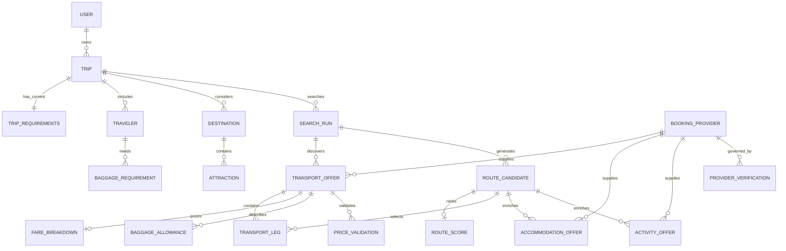

# AI Travel Optimizer — Data Model

**Status:** Proposed logical model; this document does not change Drizzle schema or migrations.  
**Storage target:** PostgreSQL via the repository’s existing Drizzle ORM.  
**Design companion:** [TECHNICAL_ARCHITECTURE.md](./TECHNICAL_ARCHITECTURE.md).

## 1. Modeling rules

1. **Persist immutable observations.** A provider search result and each later price validation are separate facts at separate timestamps. Do not overwrite the original quote when repricing.
2. **Unknown is not zero.** Missing fare, fee, baggage, seller, time zone, or availability data remains `null`/unknown with a completeness reason. It cannot be silently imputed.
3. **Exact money only.** Never use IEEE-754 floating point for stored or compared monetary totals. Use integer minor units (`BIGINT`) plus ISO currency code where that currency’s minor-unit exponent is known. Store provider decimal strings exactly at ingestion; normalize using a maintained currency exponent table. For currencies without a conventional minor unit or with special precision, store exact decimal as PostgreSQL `NUMERIC` and represent it as a decimal string in TypeScript. Currency conversion is a separate dated `ExchangeRateSnapshot`, not an implicit addition across currencies.
4. **Retain source and conditions.** Each offer preserves provider/source, actual seller, retrieval time, source offer ID, expiry, fare conditions, and availability/validation state.
5. **Retain local time context.** Store event instants as PostgreSQL `TIMESTAMPTZ` and also preserve the IANA timezone and local date/time string supplied or interpreted at the station/airport. Date-only trip constraints are PostgreSQL `DATE`; never convert them to UTC midnight. This preserves the traveler’s intended local calendar day and the actual event instant, including cross-midnight and DST cases.
6. **Snapshot requirements and algorithm versions.** Every search run refers to an immutable requirements snapshot, provider configuration/coverage snapshot, and optimizer version so results are explainable later.
7. **Enforce ownership.** Saved trips belong to a user/account. If the first UI allows anonymous planning, keep persistence policy explicit and add a signed owner/session identifier; do not expose unowned trip UUIDs as authorization.

## 2. Entity relationship overview

The diagram is conceptual: implementation may use join tables (for example `RouteCandidateLeg`) rather than the illustrative direct relation. Provider offer records are independent supplier observations; route candidates reference selected offers/legs rather than copying their claims as new supplier facts.

## 3. Core entities

### User

| Field | Type / notes |
|---|---|
| `id` | UUID primary key; stable internal identity. |
| `externalSubject` | Nullable unique auth-provider subject; never store an auth secret here. |
| `email` | Nullable and access-controlled; avoid putting in logs. |
| `createdAt`, `updatedAt` | `TIMESTAMPTZ`. |

**Relations:** one User owns many Trips. Authentication vendor is intentionally undecided. Add account deletion/retention policy before launch.

### Trip

| Field | Type / notes |
|---|---|
| `id`, `userId` | UUID primary key and ownership FK (or explicit anonymous owner token strategy). |
| `title` | Optional user-editable display label. |
| `originalPrompt` | Optional protected text; redact from logs and retain only as product needs/terms permit. |
| `status` | Draft, ready, searching, results available, needs clarification, failed, archived. This is trip lifecycle, not provider offer validation. |
| `currentRequirementsId` | FK to current immutable TripRequirements snapshot. |
| `createdAt`, `updatedAt`, `archivedAt` | `TIMESTAMPTZ`. |

**Relations:** User 1:N Trip; Trip 1:N requirement snapshots, travelers, destinations, search runs, and saved candidate selections.

### TripRequirements

Immutable, versioned constraints used for one planning state. User edits create a new row/version rather than changing the snapshot used by an existing SearchRun.

| Field | Type / notes |
|---|---|
| `id`, `tripId`, `version` | UUID, FK, unique `(tripId, version)`. |
| `originPlaceId`, `originCode`, `originLabel` | Canonical reference when resolved plus user-facing input; airport/station/city may be different granularities. |
| `departureEarliestLocalDate`, `departureLatestLocalDate` | `DATE`; captures flexible windows without UTC coercion. Nullable bounds for open-ended requests. |
| `returnPlaceId`, `returnCode`, `returnLabel` | Independent of origin; supports different return airport/city. Nullable for one-way/open-ended trip. |
| `returnEarliestLocalDate`, `returnLatestLocalDate` | `DATE`; independent flexibility. |
| `tripTimezone` | Nullable IANA zone if one zone is meaningful; otherwise locality is retained on each requirement/place/event. |
| `destinationPrompt` | Natural-language destination intent; separate from parsed destinations. |
| `allowedModes` | Normalized set of flight/train/bus. Prefer join table if queries by mode become common; JSONB acceptable for an immutable snapshot. |
| `transportPriority` | `lowest_cost`, `balanced`, `more_places`. |
| `maximumStops`, `minimumStayNights`, `maximumStayNights` | Nullable explicit bounds; no hidden assumptions. |
| `maximumGroundTimeMinutes`, `maximumTransfers`, `overnightTravelAllowed` | Nullable/explicit preference constraints. |
| `preferredCurrency` | Display/comparison preference, not proof that all offers use that currency. |
| `approvedSellerIds` | Explicit allow-list snapshot; also preserve trust-policy version used. |
| `extractionSource`, `extractionConfidence`, `confirmationState` | E.g. structured input, user text, parser suggestion; pending/confirmed. Preserve unknown/ambiguous fields. |
| `createdAt`, `createdBy`, `schemaVersion` | Audit and evolution. |

**Validation:** Zod DTO schema enforces dates, bounds, allowed modes and cross-field rules. Database constraints enforce version uniqueness and valid references; do not rely on JSONB TypeScript types alone for integrity-critical data.

### Traveler

| Field | Type / notes |
|---|---|
| `id`, `tripId` | UUID and FK. |
| `travelerType` | Adult/child/infant or provider-neutral category; exact date of birth is not required unless supplier request requires it. Minimize PII. |
| `ageAtTravel` | Optional integer or age band if supported; avoid DOB if age suffices. |
| `providerPassengerTypeCode` | Nullable provider-specific mapped code, not the canonical identity. |
| `createdAt`, `updatedAt` | `TIMESTAMPTZ`. |

**Relations:** Trip 1:N Traveler; traveler 1:N BaggageRequirement. Passenger identity details for a future booking should be a separately scoped encrypted/short-lived domain, not casually added to planning rows.

### BaggageRequirement

| Field | Type / notes |
|---|---|
| `id`, `travelerId` | UUID and FK. |
| `kind` | Personal item, cabin bag, checked bag, or provider-neutral category. |
| `quantity` | Non-negative integer. |
| `maxWeightGrams`, `maxLengthMm`, `maxWidthMm`, `maxHeightMm` | Nullable exact integer measurements; traveler preference/limit. |
| `required` | Whether optimizer must satisfy this requirement. |
| `createdAt` | `TIMESTAMPTZ`. |

The current repository stores one trip-level `{checkedBags, carryOnBags}` shape. That is a useful initial UI contract, but normalize to traveler/segment-aware records before comparing multi-carrier or multi-traveler offers.

### Destination

| Field | Type / notes |
|---|---|
| `id`, `tripId` | UUID and FK. |
| `placeId`, `placeType` | Canonical catalog ID and city/region/country/airport/station classification; nullable until resolved. |
| `name`, `countryCode`, `latitude`, `longitude` | Display/location fields; coordinates as PostgreSQL numeric/decimal, not float for persisted exact coordinates if source precision must be preserved. |
| `requested`, `proposed`, `confirmed` | Distinguish user-required destinations from optimizer suggestions. |
| `priority`, `minimumNights`, `maximumNights`, `sequenceConstraint` | Nullable user preferences/constraints. |
| `localTimezone` | IANA zone when resolvable. |
| `createdAt` | `TIMESTAMPTZ`. |

### Attraction

| Field | Type / notes |
|---|---|
| `id`, `destinationId` | UUID and FK. |
| `providerId`, `providerAttractionId` | Nullable provider/catalog identity; unique per provider when supplied. |
| `name`, `description`, `latitude`, `longitude`, `localTimezone` | Canonicalized content with source attribution. |
| `estimatedDurationMinutes` | Nullable; distinguish a provider estimate from measured duration. |
| `openingHours` | Nullable structured schedule with source and observation time. Unknown means unknown; activity hours are not automatically venue opening hours. |
| `contentRetrievedAt`, `createdAt`, `updatedAt` | `TIMESTAMPTZ`. |

Attraction content can be cached separately from a date-specific `ActivityOffer`; opening hours and ticket inventory change on different schedules.

### BookingProvider

| Field | Type / notes |
|---|---|
| `id` | Stable internal identifier; provider adapter namespace. |
| `displayName`, `providerKind` | Airline/direct supplier, authorized OTA/aggregator, rail/bus seller, lodging, activities, or multi-category. |
| `enabled` | Operational feature flag, not evidence of authorization. |
| `permittedOperations` | Versioned operations allowed (search, reprice, referral, booking); purchase permissions must be separately gated. |
| `supportedModes`, `markets`, `capabilities` | Versioned provider-declared coverage. Unknown capabilities stay unknown. |
| `documentationUrl`, `termsUrl`, `lastTermsReviewedAt` | Audit references. |
| `createdAt`, `updatedAt` | `TIMESTAMPTZ`. |

Credentials are not stored in this table. Secret references point to deployment secret storage and are loaded only by server-side adapters.

### ProviderVerification

Append-only review/verification facts about provider access and capability; separate from per-offer PriceValidation.

| Field | Type / notes |
|---|---|
| `id`, `providerId` | UUID/FK. |
| `verificationType` | Account approval, authorized use, market coverage, seller identity, baggage fields, live data, booking/referral, terms review. |
| `status` | Unknown, pending, verified, rejected, expired. |
| `evidenceUrl`, `evidenceReference`, `notes` | Official docs or contract reference; no credentials/secrets. Restrict confidential notes. |
| `validFrom`, `validUntil`, `verifiedAt`, `verifiedBy` | Timestamps/actor. |
| `capabilitySnapshot` | JSONB validated by versioned schema; only for flexible evidence, not essential relational flags. |

### SearchRun

| Field | Type / notes |
|---|---|
| `id`, `tripId`, `requirementsId` | UUIDs/FKs; exact immutable requirements snapshot. |
| `status` | Queued, running, partially complete, complete, failed, cancelled. |
| `requestedAt`, `startedAt`, `completedAt` | `TIMESTAMPTZ`. |
| `optimizerVersion`, `normalizationVersion` | Reproducibility identifiers. |
| `providerCoverageSnapshot` | Provider IDs, modes, market/date coverage, enabled/disabled reasons, and policy review versions for this run. |
| `searchParameters` | Validated snapshot of candidate limits and search bounds. Avoid credentials and unbounded raw request data. |
| `failureCode`, `safeFailureMessage` | User-safe summary; detailed diagnostics go to redacted logs. |
| `correlationId` | Trace across route handler/provider/log events. |

One Trip has many SearchRuns. Each run can have per-provider sub-status rows as `ProviderSearchAttempt` (recommended) containing requested coverage, start/end, status, count, retry-after, and safe error. A provider timeout does not erase successful providers’ results.

### TransportLeg

Canonical schedulable segment. A multi-segment provider offer has one or more legs. Route candidates point at ordered legs through a join table.

| Field | Type / notes |
|---|---|
| `id`, `offerId` | UUID and offer FK for observed supplier leg; reusable route selection uses `RouteCandidateLeg` join. |
| `sequenceNumber`, `mode` | Ordered integer; flight/train/bus. |
| `marketingCarrier`, `operatingCarrier`, `operatorId`, `serviceNumber` | Nullable and source-preserved. |
| `originPlaceId`, `originCode`, `originName`, `originTimezone` | Station/airport/stop identity and IANA zone. |
| `destinationPlaceId`, `destinationCode`, `destinationName`, `destinationTimezone` | Same for arrival. |
| `departureAt`, `arrivalAt` | Actual scheduled instants as `TIMESTAMPTZ`. |
| `departureLocal`, `arrivalLocal` | Original/local timestamp strings or local datetime without offset, retained for fidelity. |
| `sourceTimezoneId` | Provider/source timezone ID if different from normalized IANA identifier. |
| `durationSeconds`, `distanceMeters` | Nullable integer measurements. |
| `retrievedAt`, `sourceData` | Observation time and permitted normalized metadata. |

Do not store an ambiguous local timestamp without an offset/timezone. UTC instant plus source/local time context supports local itinerary display and DST audit.

### TransportOffer

One provider-returned priced itinerary, potentially containing multiple legs.

| Field | Type / notes |
|---|---|
| `id`, `searchRunId`, `providerId` | UUID/FKs. |
| `providerOfferId`, `sourceName`, `sourceRetrievedAt` | Provider ID and origin of observation. `sourceRetrievedAt` can differ from app persistence time. |
| `sellerId`, `sellerName`, `sellerType` | Actual seller/merchant when known; nullable seller identity yields incomplete trust state. Do not assume carrier = seller. |
| `currency`, `quotedTotalMinor` | ISO currency and exact integer minor units or exact decimal representation with currency exponent policy. Nullable if absent. |
| `offerStatus` | Retrieved, repriced, booking-ready, stale, unavailable, incomplete. Booking-ready must be supplier-returned evidence, not inferred from freshness. |
| `retrievedAt`, `expiresAt`, `validatedAt` | `TIMESTAMPTZ`; source and app times remain distinct. |
| `conditions` | Fare rules, refund/exchange restrictions, ticketing, included services as structured source-attributed fields or validated JSONB. |
| `bookingUrl`, `bookingUrlHost`, `handoffType` | Nullable provider-supplied/documented referral, official seller, or API booking path. Validate scheme/host. |
| `bagCompleteness`, `priceCompleteness`, `sourcePayloadHash` | Derived explicit completeness; hash for idempotence/audit if raw response cannot be retained. |
| `createdAt` | `TIMESTAMPTZ`. |

The current schema uses integer amounts and JSONB legs/baggage. Before production, choose PostgreSQL `BIGINT` or exact `NUMERIC` according to currency policy; move important legs and baggage to relational rows for constraints and reporting. A JSONB snapshot may remain for provider-specific terms with schema versioning.

### FareBreakdown

One row per monetary component is preferred over a single fare plus baggage total.

| Field | Type / notes |
|---|---|
| `id`, `transportOfferId` | UUID/FK. |
| `componentType` | Base fare, tax, carrier surcharge, seat, required bag fee, optional bag fee, provider fee, other mandatory, discount. |
| `scopeType`, `scopeId` | Offer, traveler, leg, or bag requirement association. |
| `amountMinor`, `currency` | Exact amount; can be negative only for explicitly modeled discount/credit. |
| `mandatory`, `includedInQuotedTotal` | Required to compute comparable total without double counting. |
| `source`, `retrievedAt` | Attribution and timestamp. |
| `description`, `conditionCode` | Human-readable caveat/provider code. |

Sum components only under a canonical rule that prevents included fare components from being added twice. Preserve provider quoted total separately from a computed normalized total and note any discrepancy.

### BaggageAllowance

| Field | Type / notes |
|---|---|
| `id`, `transportOfferId` | UUID/FK. |
| `travelerId`, `legId` | Nullable FKs to traveler/leg scope; null may mean provider only returned offer-wide data. |
| `kind`, `quantityIncluded` | Personal item/cabin/checked; nullable quantity means unknown, not zero. |
| `maxWeightGrams`, `maxLengthMm`, `maxWidthMm`, `maxHeightMm` | Nullable exact values; units normalized from provider. |
| `feeAmountMinor`, `feeCurrency`, `feeMandatory` | Nullable exact fee for required bag count/scope. Unknown fee stays null. |
| `sourceText`, `sourceRetrievedAt`, `confidence/status` | Preserve provider statement and evidence quality; do not infer a carrier policy. |

Total fare comparability is a derived state: every traveler’s mandatory bag requirement must be satisfied by included allowance or a known applicable add-on price for every relevant leg. Unknown policy/price makes the offer incomplete for cheapest ranking.

### PriceValidation

An append-only observation from a provider’s documented reprice/availability/readiness operation.

| Field | Type / notes |
|---|---|
| `id`, `transportOfferId`, `providerId` | UUID/FKs. |
| `requestedAt`, `respondedAt` | `TIMESTAMPTZ`. |
| `status` | Repriced/validated, booking-readiness confirmed, price changed, stale, unavailable, incomplete, provider error. |
| `quotedTotalMinor`, `currency` | Exact returned total at validation. |
| `expiresAt` | Nullable supplier expiry. |
| `conditionsSnapshot`, `baggageSnapshot` | Validated normalized facts at that moment. |
| `providerValidationReference` | Supplier token/ID only if safe/allowed; protect and expire as required by terms. |
| `safeMessage`, `errorCode` | User-safe status; no secret or raw trace. |

Never treat a validation event as a purchase or reservation unless the provider explicitly states that a hold was created and product policy supports that feature.

### RouteCandidate and RouteScore

**RouteCandidate** stores a feasible proposed sequence for a SearchRun.

| Field | Type / notes |
|---|---|
| `id`, `searchRunId` | UUID/FK. |
| `ordinal`, `label` | Stable display order and explanatory label (cheapest found, balanced, more places). |
| `status` | Generated, feasible, infeasible, incomplete, selected, superseded. |
| `coverageLabel`, `priceCompleteness`, `feasibilityReasons` | Explicit evidence/unknowns and rejection reasons. |
| `transportTotalMinor`, `transportCurrency` | Nullable exact comparable sum only; never sum cross-currency raw amounts. |
| `totalDurationSeconds`, `travelDistanceMeters`, `uniqueDestinationCount` | Nullable exact integer metrics. |
| `createdAt`, `optimizerVersion` | Timestamp/version. |

**RouteCandidateLeg** joins candidate to a TransportOffer/TransportLeg with `sequenceNumber`, selected traveler/baggage scope, and optional transfer link. This makes it clear which sourced offer supplied each segment.

**RouteScore** is one row per candidate/profile/version:

| Field | Type / notes |
|---|---|
| `id`, `routeCandidateId` | UUID/FK. |
| `profile` | Lowest cost, balanced, more places, or future user-defined objective. |
| `algorithmVersion`, `weightsSnapshot` | Reproducible scoring definition; do not hide changing weights. |
| `costScore`, `timeScore`, `placesScore`, `burdenScore`, `completenessScore`, `overallScore` | Bounded integer/decimal score representation with documented scale. No monetary float arithmetic. |
| `rank`, `explanation` | Rank within profile and human-readable component tradeoffs. |

Cost objective should not score candidates with incomplete required price as though their unknown cost were free or expensive. They may be shown separately as incomplete, not ranked against complete totals.

### AccommodationOffer

| Field | Type / notes |
|---|---|
| `id`, `searchRunId`, `routeCandidateId`, `providerId`, `destinationId` | UUID/FKs; candidate/destination links may be nullable before association. |
| `providerOfferId`, `propertyId`, `propertyName`, `propertyType` | Stable provider and canonical identity where available; hotel/hostel/dorm/apartment/etc. |
| `checkInDate`, `checkOutDate`, `timezone` | Local `DATE` boundaries and property IANA zone if known. |
| `occupancySnapshot`, `roomType`, `roomCount` | Validated occupancy and exact returned room/product. |
| `quotedTotalMinor`, `currency`, `fareBreakdown` | Exact price components, taxes/fees, cancellation/payment terms; preserve quote and detail separately. |
| `availabilityStatus`, `retrievedAt`, `expiresAt`, `validatedAt` | Source status and timestamps. |
| `sellerId`, `bookingUrl`, `handoffType` | Referral versus API booking identity/flow. |
| `conditions`, `createdAt` | Policies and persistence time. |

Do not assume every provider result is available on its consumer website or that a search result remains bookable.

### ActivityOffer

| Field | Type / notes |
|---|---|
| `id`, `searchRunId`, `routeCandidateId`, `providerId`, `destinationId`, `attractionId` | UUID/FKs; attraction may be a provider product cached separately. |
| `providerProductId`, `productName`, `localStartAt`, `timezone`, `durationMinutes` | Product identity, event time and estimate; nullable when not supplied. |
| `serviceDate`, `occupancySnapshot`, `ticketType` | Local activity date and ticket selection. |
| `quotedTotalMinor`, `currency`, `conditions` | Exact total and cancel/change/inclusion terms. |
| `availabilityStatus`, `retrievedAt`, `expiresAt`, `validatedAt` | Provider state and timestamps. |
| `sellerId`, `bookingUrl`, `handoffType` | Referral/booking identity. |

Venue opening hours belong to sourced Attraction content; ticket departure/session availability belongs to ActivityOffer. Keep them separate.

## 4. Supporting records and enums

Recommended supporting tables/types:

- **`RouteCandidateAccommodation` / `RouteCandidateActivity`** if an offer can be linked to multiple candidate revisions, instead of one nullable candidate FK.
- **`ProviderSearchAttempt`** per provider and mode within a SearchRun, with response count, timings, coverage, retry-after and safe failure details.
- **`ExchangeRateSnapshot`** with base/quote currency, exact decimal rate, source, observed timestamp and expiry. A conversion is explanatory, not a supplier quote.
- **`Place`** canonical airports, stations, cities, local timezone, coordinates and source attribution. Place resolution may begin as provider/airport codes; add a place catalog only when the chosen geocoding source is known.
- **`ConversationMessage` / `RequirementExtraction`** only if conversation history or parser audit is required. Keep original message and extracted candidate values access-controlled and retention-limited.
- **`HandoffApproval`** in a future phase to record user-approved offer/version, validation ID, displayed total, seller, approval timestamp and resulting redirect/order state. No purchase implementation is implied here.

Suggested Postgres enums (or constrained text where evolution is frequent): `trip_status`, `search_run_status`, `provider_attempt_status`, `transport_mode`, `offer_validation_status`, `baggage_kind`, `price_component_type`, `provider_verification_status`, `route_profile`, `availability_status`, `handoff_type`.

## 5. Keys, indexes, constraints, and retention

- Foreign keys cascade trip-owned dependent planning rows only where deletion semantics are clear. Provider reference data should not be deleted when a provider is disabled.
- Unique: `(tripId, version)` requirements; `(providerId, providerOfferId, searchRunId)` offers when provider IDs are stable; `(providerId, providerAttractionId)` content; `(routeCandidateId, sequenceNumber)` route leg order.
- Check: amounts nonnegative except explicitly allowed discount components; currencies uppercase ISO codes; counts/durations nonnegative; valid date windows; `arrivalAt > departureAt`; `expiresAt >= retrievedAt` when both known.
- Index: `(userId, updatedAt)` trips; `(tripId, requestedAt DESC)` runs; `(searchRunId, status)`; `(providerId, providerOfferId)`; `(routeCandidateId, rank)`; local dates/place IDs for accommodation/activity lookup.
- Keep validation/history rows immutable. Add a retention policy for raw prompt, provider payload, property/activity content, and expired provider references based on provider contracts and privacy needs.
- Use JSONB only for versioned provider-specific metadata, user requirement snapshots, or source fields whose shape varies. Add Zod schemas and schema versions; keep queryable and integrity-critical concepts relational.

## 6. Current schema gap and migration direction

The current Drizzle schema has `trips` and `transport_offers`; the latter already retains provider/source, retrieval time, price/currency, seller, validation status, booking URL, conditions and legs. The trip request validator already handles origin/return destination, optional date window, date flexibility, destination prompt, allowed modes, baggage counts, priority and approved sellers. The price helper returns a comparable total only when the fare and baggage charge are known, in the same currency, and requirements are satisfied.

Before adding real providers, evolve the current schema incrementally:

1. Add users/ownership or an explicit anonymous-session owner model and immutable TripRequirements snapshots.
2. Add SearchRun and ProviderSearchAttempt; make existing offers belong to a run as well as a trip.
3. Replace generic bag total fields with FareBreakdown and per-scope BaggageAllowance while retaining status/unknown semantics.
4. Normalize `TransportLeg` as relational rows and use PostgreSQL `BIGINT` or exact `NUMERIC` for amounts; document the selected currency exponent policy and adapt JSON/API money representation to decimal strings.
5. Add Provider registry/verification, PriceValidation history, route candidate/join/score records.
6. Add lodging/activity data only after a provider is approved and transport optimization is working.

Use Drizzle-generated migrations, inspect generated SQL, and test migration behavior against a disposable PostgreSQL database. Do not silently reinterpret current JSONB baggage fields as authoritative per-leg data.

## 7. Proposed implementation plan with dependency ordering

### Phase 0 — Confirm runtime and contracts

1. Confirm anonymous versus authenticated trip ownership and retention requirements.
2. Confirm money API format: `{ amountMinor: string, currency }` for database/API safety, or exact decimal string where minor-unit convention is unsuitable; never serialize JavaScript bigint as JSON directly.
3. Confirm which provider accounts and documented capabilities have actually been granted using [provider research](./PROVIDER_RESEARCH.md). Leave unapproved providers disabled.
4. Agree minimum input semantics: date flexibility, passenger ages/categories, required bags per traveler, endpoints, seller allow-list, and when the user confirms parser-inferred constraints.

### Phase 1 — Canonical primitives and schemas

1. Define currency/exact-money value object, currency exponent policy, and arithmetic/comparison functions.
2. Define local date, IANA timezone, event instant/local datetime, place, traveler, baggage, offer lifecycle, availability, seller, and source timestamp contracts.
3. Expand Zod input and provider response schemas. Add unknown/incomplete states and strict parsing tests.
4. Acceptance: arithmetic is exact; currency mixing is rejected absent an explicit FX snapshot; missing baggage is not zero; DST and open-jaw values preserve intent.

### Phase 2 — Relational persistence and ownership

1. Introduce User/Trip ownership and immutable TripRequirements versions.
2. Add SearchRun and provider-attempt state.
3. Add TransportLeg, FareBreakdown, BaggageAllowance, TransportOffer, PriceValidation, and ProviderVerification foundations.
4. Add repositories/transactions and Drizzle migrations with FK/check/index review.
5. Acceptance: create/update requirements without mutating old snapshots; append offer and validation records; enforce ownership; migration/repository integration tests pass.

### Phase 3 — Trust registry and provider contract

1. Build the provider registry/capability model and seller allow-list policy.
2. Refine existing `TransportProvider` interface into mode-specific search/reprice contracts with explicit coverage and canonical output.
3. Add timeouts, concurrency limits, retries respecting `Retry-After`, safe errors, and structured redacted logs.
4. Acceptance: disabled/unapproved/missing-credential provider cannot be invoked; invalid response rejected; no secret appears in DTO/log tests.

### Phase 4 — First transport adapters and truthful search lifecycle

1. Select one flight and one ground provider only after commercial access and baggage/route coverage questions are answered.
2. Implement adapters and sanitized/synthetic fixtures for unit/contract tests; clearly label fixture results as simulated and isolate them from live status.
3. Persist SearchRun and provider attempts, canonical offers and source timestamps; record partial failure and provider coverage.
4. Add documented offer repricing and PriceValidation append path.
5. Acceptance: current status distinctions work; baggage-inclusive comparable totals only for fully known bag costs; timeouts/partial provider failures yield honest, recoverable states.

### Phase 5 — Feasibility and route optimization

1. Implement location/timezone and transfer/connection feasibility.
2. Generate bounded candidate paths for one-way, return, open-jaw, flexible date and multi-city inputs supported by providers.
3. Add deterministic profile ranking and RouteCandidate/RouteScore persistence.
4. Acceptance: unit/integration fixtures cover disconnected paths, date bounds, DST, overnight legs, different return airport, seller rejection, unknown baggage, and non-global search coverage wording.

### Phase 6 — API and planner/dashboard

1. Add trip/search/run/validation endpoints with Zod DTOs, auth/ownership and idempotency.
2. Compose dashboard DTOs with route map coordinates, leg-local times, transport totals, validation states, coverage and alternative explanations.
3. Ensure UI distinguishes live provider results from simulated fixtures and incomplete/stale prices.
4. Acceptance: route handler integration tests exercise auth, schemas, idempotency, safe errors and no order side effects.

### Phase 7 — Lodging and activity enrichment

1. Add accommodation/activity provider verification and offer schemas only after approval.
2. Search based on selected transport candidates and exact destination stay dates/occupancy.
3. Recalculate full-trip costs separately from transport optimization and show source/price timestamps.
4. Acceptance: missing availability/price does not become a recommendation; transport-only score remains auditable; opening hours are unknown unless supplied.

### Phase 8 — Handoff and hardening

1. Add offer revalidation/approval record and provider-supported referral handoff.
2. Keep transactional booking and payment out of scope unless a later product phase explicitly authorizes them and obtains required legal/provider access.
3. Add monitoring, provider quotas, retention controls, deployment secrets, backup/migration practices and security review.
4. Acceptance: stale/changed offer blocks or refreshes handoff; explicit user approval is recorded; ordinary search never purchases; operational errors are correlated and safe.
